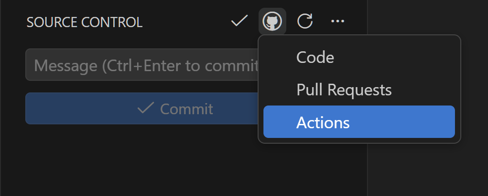

# Open on GitHub

Quickly open your GitHub repository's **Code**, **Issues**, **Pull Requests**, and **Actions** pages directly from the Source Control view in VS Code.

## Features

- Adds a **GitHub** submenu (with the `$(github)` icon) to the Source Control title bar
- One-click access to four key GitHub pages:
  - **Code** — opens the current branch if it exists on `origin`, otherwise the repository home page
  - **Issues** — opens the issues tab
  - **Pull Requests** — opens the pull requests tab
  - **Actions** — opens the GitHub Actions tab
- Automatically reads the `origin` remote URL from your repository
- Supports both SSH and HTTPS remote formats
- Supports multi-repository workspaces using the selected Source Control repository, with a repository picker when the choice is ambiguous

## Usage

1. Open a project that has a GitHub remote configured
2. Navigate to the **Source Control** view
3. Click the **GitHub** icon in the title bar
4. Select **Code**, **Issues**, **Pull Requests**, or **Actions**

Your default browser will open the corresponding GitHub page.

In a workspace with multiple repositories, a repository's own GitHub menu always targets that repository. Commands without repository context use the selected Source Control repository. If multiple GitHub repositories are selected, or none is selected and multiple GitHub repositories are available, you will be prompted to choose one. A selected repository without a GitHub `origin` shows a warning instead of opening a different repository.

## Requirements

- A Git repository with a GitHub `origin` remote

## Extension Settings

This extension has no configurable settings.

## License

[MIT](LICENSE)

## Reporting Issues

Use the [issue forms](https://github.com/gasrulle/open-on-github/issues/new/choose) to report a bug, request a feature, or ask a question. Keep separate bugs and feature requests in separate issues. For bugs, include your VS Code and extension versions, workspace layout, command entry point, and reproduction steps. Remove credentials and private repository information from remote URLs, logs, and screenshots.
